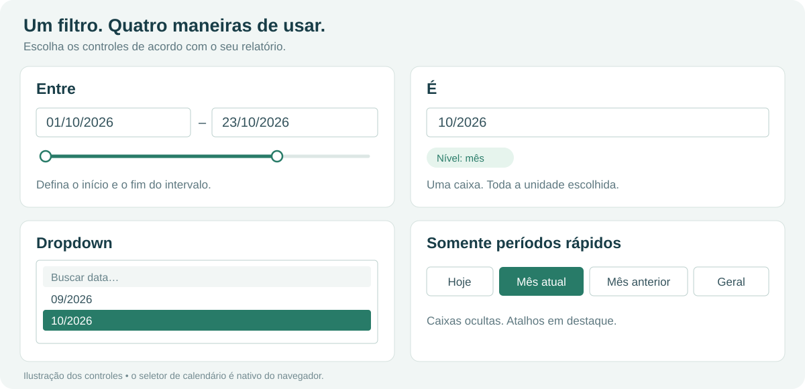

# TempoFlex

**Seu período, suas regras. Um filtro de datas flexível para Power BI.**


[](LICENSE)
[](pbiviz.json)
[](src/visual.ts)

TempoFlex reúne **seleção de datas**, **calendário nativo**, **controle deslizante** e **períodos rápidos configuráveis** em um visual do Power BI. Crie atalhos como Hoje, Mês anterior e Ano atual, ou use ciclos próprios, como um mês de competência que começa no dia 26. Sem tabela ou medida auxiliar.

Desenvolvido por **Lucas Machado Balbinot**. Versão atual: **1.4.5**.

## Documentação

| Precisa de… | Consulte |
|---|---|
| Instalar e configurar o visual | [Manual completo](docs/MANUAL.md) |
| Copiar exemplos de períodos e variáveis | [Receitas prontas](docs/MANUAL.md#receitas-prontas) |
| Compilar, testar e entender o código | [Guia de desenvolvimento](docs/DESENVOLVIMENTO.md) |
| Preparar o repositório e uma release pública | [Guia de publicação](docs/PUBLICACAO.md) |
| Reportar um problema ou contribuir | [Como contribuir](CONTRIBUTING.md) |
| Preparar a oferta e conferir pendências do AppSource | [Kit AppSource](appsource/README.md) |
| Dados fictícios e roteiro de demonstração offline | [Demonstração](demo/README.md) |
| Suporte, privacidade e termos | [Suporte](SUPPORT.md) · [Privacidade](PRIVACY.md) · [Termos](TERMS.md) |
| Consultar as mudanças por versão | [Histórico de versões](CHANGELOG.md) |
| Entender as permissões de uso e modificação | [Licença GPL-3.0](LICENSE) |

## O que você pode fazer

- Usar **Entre** com duas caixas, **É** com uma caixa ou **Dropdown** com busca e datas em ordem cronológica.
- Filtrar por **ano, mês, dia, hora, minuto ou segundo**.
- Abrir o **seletor nativo do navegador**, que pode ultrapassar a área do visual, inclusive em filtros pequenos.
- Ocultar as caixas e trabalhar **somente com períodos rápidos**.
- Mostrar ou ocultar o deslizante; no modo É ele usa uma alça.
- Criar períodos relativos com expressões simples e escolher um período padrão.
- Definir ciclos mensais, anos fiscais e variáveis reutilizáveis.
- Organizar os botões em linha, coluna ou grade, com posição, fonte e cores configuráveis.
- Consultar um guia dentro do próprio visual, com exemplos e erros de configuração.



*As imagens acima são ilustrações da interface. O calendário e sua aparência são fornecidos pelo navegador/Power BI.*

## Comece em poucos passos

1. [Baixe o `.pbiviz` da versão 1.4.5](https://github.com/lucasmbalbinot/TempoFlex/releases/download/v1.4.5/filtroDataPeriodoA7C31E0B5F2D4E6C9B8A.1.4.5.0.pbiviz) na [release oficial](https://github.com/lucasmbalbinot/TempoFlex/releases/tag/v1.4.5), ou [gere o pacote a partir do código](docs/DESENVOLVIMENTO.md).
2. No Power BI Desktop, abra **Visualizações → … → Importar um visual de um arquivo** e selecione o `.pbiviz`.
3. Adicione TempoFlex à página e arraste uma coluna do tipo **Data** ou **Data/Hora** para o campo **Data** do visual. Escolha a coluna, **sem a hierarquia automática**.
4. Em **Formatar visual → Caixas de data**, escolha o modo e o nível do filtro.
5. Em **Períodos rápidos → Períodos**, cole, por exemplo:

```text
Hoje = hoje
Ontem = ontem
Últimos 7 dias = hoje-6d .. hoje
* Mês atual = inicio_mes .. hoje
Mês anterior = inicio_mes-1m .. fim_mes-1m
Ano atual = inicio_ano .. hoje
Geral = tudo
```

O `*` define o período padrão. `Geral = tudo` limpa o filtro de data aplicado pelo visual. Não remove filtros de outros visuais ou da página.

### Seu mês começa no dia 26?

Em **Variáveis**:

```text
competencia = mensal dia 26
```

Em **Períodos**:

```text
* Competência atual = inicio_competencia .. hoje
Competência anterior = inicio_competencia-1m .. fim_competencia-1m
Geral = tudo
```

Veja os ciclos e outros exemplos no [manual](docs/MANUAL.md#variáveis-e-ciclos-personalizados).

## Modos e precisão

| Modo | Seleção |
|---|---|
| **Entre** | Início e fim; inclui toda a última unidade escolhida |
| **É** | Uma unidade: um dia, um mês, um ano, uma hora, um minuto ou um segundo |
| **Dropdown** | Uma unidade existente no campo, com busca e agrupamento pelo nível escolhido |
| **Somente períodos rápidos** | Caixas de data desligadas; deslizante oculto automaticamente |

Por exemplo, `10/2026` inclui outubro inteiro; `23/10/2026 14:30` inclui o minuto de 14:30:00 até antes de 14:31:00. Os períodos rápidos sempre trabalham com dias completos.

## Limitações que vale conhecer

- O calendário é **nativo**, sem calendário HTML próprio. O navegador determina os controles disponíveis: não existe um tipo nativo exclusivo de ano; nesse nível, digite o ano ou escolha uma data dele. Segundos podem ser digitados quando não aparecem no popup.
- O **dropdown com busca** é uma lista HTML e fica dentro da área do visual. O comportamento fora da área aplica-se ao calendário nativo.
- O deslizante depende das caixas e fica oculto no modo Dropdown. Se estiver ligado nessas combinações, o painel de formatação recebe um aviso.
- A lista de datas depende dos dados entregues pelo Power BI, dos outros filtros e dos limites de carregamento do host. O visual solicita segmentos adicionais e avisa quando a lista está parcial.
- Períodos relativos são recalculados quando o visual é atualizado; não há um relógio em segundo plano que atualize o relatório à meia-noite.
- As cores são configuradas no visual. Não há equivalência garantida com todas as funções do segmentador nativo nem certificação Microsoft/AppSource declarada.
- Os testes de interface usam um host simulado. Importação, sincronização, indicadores e comportamento no Power BI Desktop/Service precisam de validação no ambiente em que o relatório será usado.

## Desenvolvimento rápido

Ambiente utilizado no projeto: **Node.js 24**, npm, TypeScript e Power BI Visuals Tools 7.2.1.

```bash
npm ci
npm test
npm run typecheck
npm run lint
npm run package
```

O pacote fica em `dist/`. Dependências, certificados e saídas de build são ignorados pelo Git. Para certificados, testes no navegador e organização do código, consulte [Desenvolvimento](docs/DESENVOLVIMENTO.md).

## Publicação

O repositório oficial é [lucasmbalbinot/TempoFlex](https://github.com/lucasmbalbinot/TempoFlex). A publicação comum no AppSource ainda não foi enviada. O kit inclui logo 300 × 300, textos em português/inglês, URLs legais, dados offline e comandos para gerar pacotes. As imagens `appsource/media/preview-*` são **ilustrações**, não screenshots do Power BI.

```bash
npm run release:prepare
npm run release:check -- --submission
```

O primeiro comando gera o pacote e registra pendências. O segundo exige PBIX, screenshots reais e evidências de teste; deve falhar enquanto esses itens estiverem pendentes. Os scripts não abrem aplicativos, não fazem push e não enviam ofertas. Veja o [checklist](appsource/CHECKLIST.md).

## Licença

Copyright © 2026 Lucas Machado Balbinot.

Este projeto é disponibilizado sob a **GNU General Public License v3.0 somente** (`GPL-3.0-only`). Você pode usar, estudar, modificar e redistribuir o software, inclusive comercialmente, nos termos da licença.

Ao distribuir uma versão modificada, disponibilize o código-fonte correspondente aos destinatários, preserve os avisos exigidos e mantenha o trabalho coberto sob a GPL-3.0. Modificações apenas privadas não exigem publicação. A licença não obriga enviar um pull request nem publicar o código especificamente no GitHub. Consulte o [texto integral](LICENSE) e as [explicações oficiais da GNU](https://www.gnu.org/licenses/gpl-faq.html#GPLRequireSourcePostedPublic).

O software é oferecido **sem garantia**, conforme a licença. Dependências mantêm suas próprias licenças; veja os [avisos de terceiros](THIRD_PARTY_NOTICES.md). Power BI é um produto da Microsoft; TempoFlex é um projeto independente.
