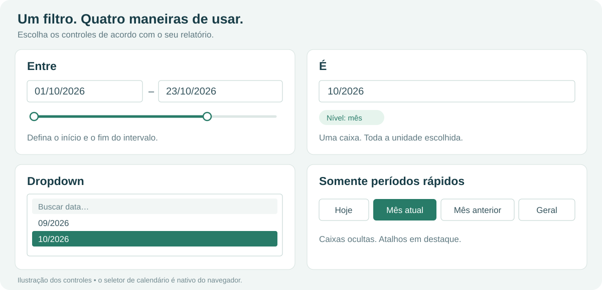

# Manual do TempoFlex

[← Voltar ao README](../README.md)

Este manual explica a instalação, todos os controles, a linguagem dos períodos rápidos e a configuração da aparência.

## Sumário

- [Instalação e atualização](#instalação-e-atualização)
- [Configuração inicial](#configuração-inicial)
- [Modos de seleção](#modos-de-seleção)
- [Nível do filtro e formato](#nível-do-filtro-e-formato)
- [Calendário nativo e teclado](#calendário-nativo-e-teclado)
- [Controle deslizante](#controle-deslizante)
- [Períodos rápidos](#períodos-rápidos)
- [Variáveis e ciclos personalizados](#variáveis-e-ciclos-personalizados)
- [Receitas prontas](#receitas-prontas)
- [Organização e aparência](#organização-e-aparência)
- [Filtros, estado e atualização](#filtros-estado-e-atualização)
- [Guia de configuração](#guia-de-configuração)
- [Solução de problemas](#solução-de-problemas)
- [Referência de configurações](#referência-de-configurações)

## Instalação e atualização

1. Obtenha o `.pbiviz` da versão desejada nas Releases, se publicada, ou compile o código conforme o [guia de desenvolvimento](DESENVOLVIMENTO.md).
2. Abra o relatório no Power BI Desktop.
3. Em **Visualizações → … → Importar um visual de um arquivo**, escolha o `.pbiviz`.
4. Adicione TempoFlex à página e arraste uma coluna **Data** ou **Data/Hora** para o campo **Data**.

Se aparecer Ano/Trimestre/Mês/Dia, abra a seta do campo e escolha a própria coluna. O visual recebe um campo de data; não recebe hierarquia nem medida textual.

O uso de visuais personalizados depende das configurações da organização. Este projeto não declara certificação AppSource.

Para atualizar, faça uma cópia do relatório, importe o pacote novo e confira configurações e filtros nas páginas utilizadas. O identificador interno do visual é preservado entre versões para permitir atualizar instâncias existentes. Use **1.4.1 ou posterior** para o calendário nativo; a versão 1.4.0 usava um calendário HTML.

## Configuração inicial

| Cartão em Formatar visual | Finalidade |
|---|---|
| Caixas de data | Visibilidade, Entre/É/Dropdown, precisão, formato e aparência dos campos |
| Períodos rápidos | Atalhos, variáveis, posição e organização dos botões |
| Botões | Fontes, cores, bordas e espaçamento |
| Controle deslizante | Visibilidade, cores das alças e trilhas |
| Guia de configuração | Ajuda e diagnóstico no modo de edição |

As caixas começam em **Entre**, nível **Dia**, formato `dd/MM/aaaa`. Caixas, períodos e deslizante vêm ligados. Os períodos padrão são Hoje, Ontem, Últimos 7 dias, Mês atual, Mês anterior, Ano atual e Geral; nenhum vem marcado com `*`.

Título, fundo geral, borda externa, sombra, tamanho e posição pertencem ao contêiner do Power BI.

## Modos de seleção



*Ilustração explicativa; a aparência acompanha a configuração do visual e do navegador.*

### Entre

Duas caixas, início e fim, com digitação, calendário nativo e deslizante opcional. O filtro inclui **toda a última unidade**: com nível Mês, `01/2026` a `03/2026` inclui janeiro, fevereiro e março completos.

Se o início for colocado depois do fim, o outro extremo acompanha a escolha para manter um intervalo válido. Selecionar todo o intervalo disponível no modo Entre limpa o filtro do visual, permitindo a entrada de novos valores após a atualização dos dados. Os filtros externos continuam valendo.

### É

Uma caixa seleciona uma unidade inteira como início e fim:

| Nível | Exemplo | Abrangência |
|---|---|---|
| Ano | `2026` | Todo o ano de 2026 |
| Mês | `10/2026` | Todo outubro de 2026 |
| Dia | `23/10/2026` | Todo o dia 23 |
| Hora | `23/10/2026 14` | Das 14:00 até antes de 15:00 |
| Minuto | `23/10/2026 14:30` | Das 14:30:00 até antes de 14:31:00 |
| Segundo | `23/10/2026 14:30:45` | Das 14:30:45 até antes de 14:30:46 |

A unidade continua filtrada mesmo quando contém todos os dados atuais. Para limpar, use um período `tudo`, o botão Limpar, se habilitado, ou os controles de limpeza do Power BI.

### Dropdown

Lista com busca, datas em ordem cronológica e sem duplicatas. Os valores são agrupados pelo nível: várias datas de outubro se tornam um único item `10/2026` quando o nível é Mês.

1. Abra a lista e digite parte do texto mostrado, como `10/2026`.
2. Escolha um item para selecionar uma unidade inteira.
3. Use **Mostrar mais** quando houver resultados adicionais.
4. Para limpar, use Geral ou o botão Limpar.

A busca procura no texto exibido, conforme o formato configurado; ela não interpreta expressões como `hoje-6d`.

O dropdown é HTML e ocupa a área do visual. Aumente a altura se precisar de mais espaço. Essa restrição não se aplica ao popup nativo do calendário.

O Power BI pode entregar dados em segmentos. TempoFlex solicita os demais segmentos e mostra um aviso quando a lista está parcial. Limites do host e outros filtros podem impedir que todas as datas do modelo apareçam.

### Somente períodos rápidos

Desligue **Caixas de data → Mostrar**, mantenha **Períodos rápidos → Mostrar** ligado e configure os botões. Caixas e deslizante ficam ocultos.

A configuração do deslizante é preservada: se continuar ligado, seu cartão recebe um aviso de que depende das caixas. Ao reativá-las em Entre ou É, ele pode reaparecer.

Ocultar controles não limpa o filtro existente. Se desligar tanto caixas quanto períodos, não haverá controles de seleção visíveis.

## Nível do filtro e formato

**Nível do filtro** controla a unidade selecionada. **Formato da data** controla a escrita da parte da data nos níveis que incluem dia. Depois de mudar a precisão, faça uma nova seleção para aplicá-la ao filtro.

| Nível | Entrada típica | Seletor nativo |
|---|---|---|
| Ano | `2026` | Data; o ano escolhido é utilizado |
| Mês | `10/2026` | Mês/ano |
| Dia | `23/10/2026` | Data |
| Hora | `23/10/2026 14` | Data/hora, com passo de hora |
| Minuto | `23/10/2026 14:30` | Data/hora, com passo de minuto |
| Segundo | `23/10/2026 14:30:45` | Data/hora, com passo de segundo |

Para mês e ano, os formatos são fixos: `mm/aaaa` e `aaaa`. Nos níveis com dia, escolha:

| Configuração | Exemplo |
|---|---|
| dd/MM/aaaa | `23/10/2026` |
| dd/MM/aa | `23/10/26` |
| dd mmm aaaa | `23 out 2026` |
| dd.MM.aaaa | `23.10.2026` |
| MM/dd/aaaa | `10/23/2026` |
| aaaa-MM-dd | `2026-10-23` |

Horas usam o ciclo de 24 horas. Na digitação com horário, forneça os componentes do nível: `14` para hora, `14:30` para minuto e `14:30:45` para segundo. Datas impossíveis ou componentes fora da faixa são rejeitados.

Os valores são tratados como datas e horários civis do campo. Não há configuração de conversão entre fusos. Normalize timestamps de origens com fusos diferentes no modelo e confira valores próximos à meia-noite.

**Limitar às datas dos dados** vem ligado e restringe a seleção às unidades que contêm a primeira e a última data recebida. Outros filtros podem alterar esses limites. Desligue para digitar intervalos fora deles; isso não cria registros, e a seleção pode ficar sem dados. Períodos rápidos podem apontar para dias fora do intervalo recebido, como um mês completo.

## Calendário nativo e teclado

O clique sobre o ícone é recebido pelo input nativo do navegador. O calendário **não é um painel HTML próprio** e pode se estender além do iframe, inclusive em visuais pequenos.

O idioma e os controles dependem do navegador ou WebView do Power BI. Há tipos nativos para data, mês e data/hora, mas não um tipo exclusivo de ano. Digite o ano ou escolha uma data dele: o filtro usa o ano inteiro. Nem todo popup apresenta segundos ou oculta componentes menores ao mudar o passo; a caixa de texto aceita a precisão configurada.

| Ação | Resultado |
|---|---|
| Digitar + Enter | Confirma a edição |
| Sair da caixa após digitar | Confirma a edição |
| Esc antes de confirmar | Restaura o valor atual |
| ↑ / ↓ na caixa | Avança/recua uma unidade do nível escolhido; confirme com Enter |
| Tab | Navega pelos controles |
| Data inválida | Indicação vermelha e retorno ao valor anterior |

No nível Dia, são aceitas formas como `1/10/26`, `01102026`, `01.10.2026`, `1 out 2026`, `2026-10-01`, `hoje` e `ontem`. Em formatos mês/dia, respeite a ordem escolhida. O calendário nativo pode exibir outra ordem conforme o idioma local.

## Controle deslizante

Duas alças em Entre e uma em É. Os passos percorrem as unidades **existentes nos dados recebidos**, na precisão escolhida. Datas ausentes não ocupam passos: a distância entre alças não representa uma escala contínua de tempo.

Ele aparece quando está ligado, as caixas estão visíveis, o modo é Entre/É e existe mais de uma unidade nos dados. No modo Dropdown fica oculto. Arrastar mostra a prévia; soltar aplica o filtro.

Cores da trilha, intervalo e alças são independentes. **Bloquear datas com período ativo** também bloqueia o deslizante, as caixas e o dropdown enquanto um período rápido com filtro estiver ativo.

## Períodos rápidos

Em **Períodos (um por linha)**:

```text
Rótulo = início .. fim
```

| Sintaxe | Exemplo | Resultado |
|---|---|---|
| Uma expressão | `Hoje = hoje` | Um único dia |
| Intervalo | `Últimos 7 dias = hoje-6d .. hoje` | Intervalo inclusivo |
| Tudo | `Geral = tudo` | Remove o filtro deste visual |
| Padrão | `* Mês atual = inicio_mes .. hoje` | Padrão no estado inicial elegível |
| Comentário | `# Minha configuração` | Linha ignorada |

Também são aceitos `até` e `;` como separadores. Linhas vazias são ignoradas. Use rótulos diferentes para facilitar a identificação e a restauração do estado.

### Âncoras

| Âncora | Significado |
|---|---|
| `hoje` | Data local atual do ambiente que executa o visual |
| `ontem` / `amanha` | Dia anterior / seguinte |
| `inicio_semana` / `fim_semana` | Limites da semana, iniciada na segunda ou no domingo |
| `inicio_mes` / `fim_mes` | Primeiro e último dia do mês |
| `inicio_trimestre` / `fim_trimestre` | Limites do trimestre civil |
| `inicio_semestre` / `fim_semestre` | Limites do semestre civil |
| `inicio_ano` / `fim_ano` | Limites do ano civil |
| `min` / `max` | Primeira / última data entregue no contexto atual |
| `15/01/2026` / `2026-01-15` | Data fixa |
| Variável do usuário | Expressão ou limite de ciclo próprio |

### Deslocamentos

Acrescente `+` ou `-`, quantidade e unidade:

| Unidade | Significado | Exemplo |
|---|---|---|
| `d` | Dias | `hoje-6d` |
| `s` | Semanas | `inicio_semana-1s` |
| `m` | Meses | `fim_mes-1m` |
| `t` | Trimestres | `inicio_trimestre-1t` |
| `a` | Anos | `inicio_ano-1a` |

Sem unidade, são dias. Pode encadear (`inicio_ano-1a+14d`) ou escrever formas por extenso (`inicio mes - 2 meses`).

Semanas, meses, trimestres e anos deslocam a **referência antes de calcular a âncora**; dias são somados depois. Assim, `fim_mes-1m` encontra o fim do mês passado, inclusive fevereiro, e `inicio_mes+14d` encontra o dia 15. A linguagem não implementa dias úteis ou feriados.

### Padrão, limpeza e bloqueio

Marque apenas um período com `*`. O padrão é aplicado quando não existe filtro e o estado permite; ele não descarta automaticamente uma seleção restaurada ou filtro persistente do Power BI.

Se existe botão `tudo`, uma limpeza gravada pode permanecer sem filtro. Sem botão `tudo`, um padrão pode reaparecer após a limpeza numa atualização seguinte. Inclua `Geral = tudo` quando quiser um estado estável sem restrição de data.

Clicar em um período aplica o filtro e destaca o botão. Clicar novamente limpa quando **Clicar no botão ativo limpa o filtro** está ligado. **Botão Limpar** adiciona um botão com texto configurável. **Bloquear datas com período ativo** impede a seleção manual até escolher Geral ou desmarcar o período, se permitido. O título exibido ao passar o mouse informa as datas calculadas.

Os períodos rápidos cobrem **dias completos**, mesmo com nível de hora, minuto ou segundo nas caixas.

## Variáveis e ciclos personalizados

Em **Variáveis (uma por linha)**, declare referências reutilizáveis. As declarações são lidas em ordem: crie uma referência antes de utilizá-la em outra variável.

### Ciclo mensal

```text
competencia = mensal dia 26
```

Cria `inicio_competencia` e `fim_competencia`, que delimitam o ciclo contendo a data de referência:

| Referência | Início | Fim |
|---|---|---|
| 22/10/2026 | 26/09/2026 | 25/10/2026 |
| 26/10/2026 | 26/10/2026 | 25/11/2026 |

Dias inexistentes são limitados ao último dia do mês; ciclos iniciados no dia 31 respeitam meses de 28, 29 e 30 dias.

### Ciclo anual / ano fiscal

```text
ano_fiscal = anual 01/04
```

Cria `inicio_ano_fiscal` e `fim_ano_fiscal`. Para 22/10/2026, são 01/04/2026 e 31/03/2027.

### Expressão

```text
competencia = mensal dia 26
fechamento = fim_competencia-2d
```

Cria a âncora `fechamento`, que pode ser usada em um período:

```text
Até o fechamento = inicio_competencia .. fechamento
```

Os nomes aceitam letras, números e `_`; acentos e espaços são normalizados. Não repita nomes nem use âncoras reservadas. O guia aponta linhas inválidas.

## Receitas prontas

### Calendário comercial básico

Cole em **Períodos**:

```text
Hoje = hoje
Ontem = ontem
Últimos 7 dias = hoje-6d .. hoje
Últimos 30 dias = hoje-29d .. hoje
Semana atual = inicio_semana .. hoje
Semana passada = inicio_semana-1s .. fim_semana-1s
* Mês atual = inicio_mes .. hoje
Mês anterior = inicio_mes-1m .. fim_mes-1m
Mesmo período do mês passado = inicio_mes-1m .. hoje-1m
Trimestre atual = inicio_trimestre .. hoje
Trimestre anterior = inicio_trimestre-1t .. fim_trimestre-1t
Ano atual = inicio_ano .. hoje
Ano passado = inicio_ano-1a .. fim_ano-1a
Ano passado até hoje = inicio_ano-1a .. hoje-1a
Últimos 12 meses = inicio_mes-11m .. hoje
Geral = tudo
```

### Competência do dia 26 ao dia 25

Em **Variáveis**:

```text
competencia = mensal dia 26
```

Em **Períodos**:

```text
* Competência até hoje = inicio_competencia .. hoje
Competência completa = inicio_competencia .. fim_competencia
Competência anterior = inicio_competencia-1m .. fim_competencia-1m
Geral = tudo
```

### Ano fiscal de abril a março

Em **Variáveis**:

```text
ano_fiscal = anual 01/04
```

Em **Períodos**:

```text
* Exercício até hoje = inicio_ano_fiscal .. hoje
Exercício completo = inicio_ano_fiscal .. fim_ano_fiscal
Exercício anterior = inicio_ano_fiscal-1a .. fim_ano_fiscal-1a
Geral = tudo
```

### Base com atualização atrasada

```text
Último dia com dados = max
Últimos 7 dias da base = max-6d .. max
Últimos 30 dias da base = max-29d .. max
Base inteira = tudo
```

`max` considera o contexto recebido, inclusive filtros de outros visuais, e não necessariamente a tabela inteira sem filtros.

### Datas fixas

```text
Campanha de outubro = 01/10/2026 .. 31/10/2026
Desde janeiro = 01/01/2026 .. hoje
Geral = tudo
```

### Seletor compacto de competências

Selecione **É**, nível **Mês**, oculte Períodos rápidos e desligue o deslizante. Digite `10/2026` ou escolha o mês no seletor nativo. Para listar as competências presentes na base, troque É por **Dropdown**.

## Organização e aparência

| Organização | Comportamento |
|---|---|
| Automática | Linha acima/abaixo das caixas; coluna nas laterais |
| Lado a lado | Linha; Quebrar linha distribui em linhas adicionais |
| Um embaixo do outro | Coluna |
| Grade | Número configurável de colunas |

Os botões podem ficar acima, abaixo, à esquerda ou à direita. O alinhamento oferece início, centro, fim e preencher.

Nas laterais, **Largura da área nas laterais (%)** controla o espaço dos botões: `0` usa largura automática, limitada a 45% com caixas visíveis; uma largura explícita aceita até 80%. Sem caixas, os botões podem ocupar toda a largura.

Algumas opções aparecem somente quando aplicáveis: Colunas da grade em Grade, Quebrar linha em Lado a lado e largura lateral nas posições laterais.

Personalize fontes, tamanhos, negrito, itálico, sublinhado, cores, bordas, arredondamento e espaçamento. Botões ativos têm cores próprias. Os controles principais consideram a paleta de alto contraste do host; confira a legibilidade no tema utilizado.

## Filtros, estado e atualização

O filtro usa a coluna associada ao campo Data. Internamente, o final é exclusivo para incluir toda a última unidade:

| Seleção | Condição conceitual |
|---|---|
| Dia 23/10/2026 | Data ≥ 23/10 00:00 e Data < 24/10 00:00 |
| Mês 10/2026 | Data ≥ 01/10 00:00 e Data < 01/11 00:00 |
| Minuto 23/10/2026 14:30 | Data ≥ 14:30:00 e Data < 14:31:00 |

O filtro recebido é a referência para a seleção. O nome do período vai no filtro, e há estado persistido para ajudar a reconhecer o botão. O código concilia atualizações atrasadas enquanto o Power BI confirma a escolha.

**Períodos relativos** são recalculados quando o visual recebe atualização. Digitação, calendário, dropdown e deslizante produzem **datas fixas**. Não existe um temporizador para atualizar à meia-noite.

O projeto inclui mecanismos para restauração de filtro e estado. Ao usar **indicadores** ou **Sincronizar segmentações**, associe o mesmo campo e teste troca de páginas, limpeza, indicadores e reabertura. O empacotador ainda informa recursos opcionais não declarados, incluindo suporte formal a bookmarks; não há garantia de equivalência em todos os cenários com o segmentador nativo.

Geral e Limpar removem somente o filtro deste visual. Não removem RLS, filtros de página/relatório, de outros visuais ou restrições do modelo. Ocultar os controles também não limpa filtros existentes.

## Guia de configuração

Ative **Guia de configuração → Mostrar guia no visual** no modo de edição. O guia cobre a área do visual e mostra regras, exemplos, âncoras, variáveis calculadas, períodos e erros com linha e motivo. Desligue ao terminar.

O guia não aparece no modo de leitura. Linhas inválidas são ignoradas; no modo de edição, uma faixa no rodapé informa os erros quando o guia está desligado.

## Solução de problemas

| Sintoma | Verificação / solução |
|---|---|
| “Arraste um campo de data” | Associe uma coluna ao campo Data |
| Mensagem sobre tipo | Use Data/Data-Hora, sem hierarquia nem texto |
| Calendário preso no visual | Use 1.4.1 ou posterior; 1.4.0 usava HTML |
| Nível ano mostra dias no popup | Digite o ano ou escolha uma data dele; não há tipo nativo só de ano |
| Popup sem segundos | Digite na caixa com nível Segundo |
| Dropdown pequeno | A lista é HTML; aumente a altura disponível |
| Faltam datas | Confira filtros externos, lista parcial e limites do Power BI |
| Deslizante ausente | Ative caixas, use Entre/É e tenha mais de uma unidade nos dados |
| Aviso no deslizante | Está ligado com caixas ocultas ou modo Dropdown |
| Datas bloqueadas | Confira bloqueio por período e permissões de interação do host |
| Entrada volta ao valor anterior | Respeite precisão, formato e datas válidas |
| Seleção vazia | Confira campo, limites e outros filtros |
| Padrão não aparece | Confira `*`, filtro existente e estado gravado |
| Padrão reaparece após limpar | Inclua `Geral = tudo` para permitir limpeza estável |
| Período não virou à meia-noite | Atualize o relatório; não há temporizador |
| Botão ignorado | Abra o guia e corrija a linha indicada |

Para reportar problemas, veja [Como contribuir](../CONTRIBUTING.md).

## Referência de configurações

### Caixas de data

| Opção | Padrão / finalidade |
|---|---|
| Mostrar | Ligado; controla caixas/dropdown e dependência do deslizante |
| Tipo de seleção | Entre; também É e Dropdown |
| Nível do filtro | Dia; também ano, mês, hora, minuto e segundo |
| Formato da data | dd/MM/aaaa; disponível nos níveis com dia |
| Alinhamento da data | Esquerda; também centro/direita |
| Fonte | Segoe UI, 10 pt; estilo configurável |
| Cores e arredondamento | Texto, fundo, borda e raio |
| Mostrar rótulos | Desligado; textos De e Até |
| Ícone de calendário | Ligado; não se aplica ao Dropdown |
| Limitar às datas dos dados | Ligado |

### Períodos rápidos

| Opção | Padrão / finalidade |
|---|---|
| Mostrar | Ligado |
| Períodos / Variáveis | Uma declaração por linha |
| Posição dos botões | Abaixo |
| Organização | Automática |
| Colunas da grade | 2; intervalo 1 a 12 |
| Alinhamento | Preencher |
| Quebrar linha | Ligado |
| Largura lateral | 0 = automático; até 80% |
| Semana começa na | Segunda; também domingo |
| Clicar no botão ativo limpa o filtro | Ligado |
| Bloquear datas com período ativo | Desligado |
| Botão Limpar | Desligado; texto inicial Limpar |

### Botões, deslizante e guia

Botões: Segoe UI 9 pt, cores de texto/fundo/borda para estados normal e ativo, raio de 4 px, espaço de 4 px, preenchimento de 4 px e largura mínima 0 (automática).

Deslizante: vem ligado; cores independentes da trilha, intervalo e alças. Guia: vem desligado e só aparece no modo de edição.
